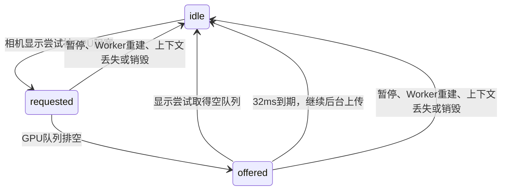

# 相机显示与资源上传的提交仲裁

当前显示/资源时钟分工见[后台世界显示切面](SDK_WORLD_DISPLAY_PLAN.md)。下面保留
提交仲裁、同步显示查询及早期足迹缓存的历史证据；产品路径已由后台切面接替
旧数值缓存，显式显示请求也纳入有界仲裁。

显示和资源推进已使用独立时钟，但GPU仍共享有序命令流。此前后台发现上传
完成后立即开始下一批，等待显示的最新相机反复碰到新上传。冻结地形的Direct
事件追踪复现219.1ms等待，期间新增8批上传、4次显示尝试。单次GPU回执等待
较短，不能用单次fence时长解释整个输入到提交间隔。

`adapters/webgl/camera_submission_priority.js`保存一个等待显示的优先请求，不
保存相机快照、纹理或几何，也不创建定时器。Renderer只在有已显示地表、相机
尚未呈现且一次真实显示尝试被GPU队列阻塞时提出请求。队列排空后，在开始
下一批上传前请求一次显示机会，至多让出32ms，即两个名义显示间隔。

新指针更新不延长已让出的窗口；显示时读取最新相机。回调缺席时后台不永久
等待，CPU准备继续，额度和原上传队列保留。首次覆盖、相机未变化和不能使用
异步GPU的路径不申请这个优先权。已有显示fence未完成时仍可跟进一批上传。
显示取得空队列后，即使暂时不能画出新地表，也结束优先权，使必要上传继续。

最大一批显示加一批资源、每轮上传字节/对象/时间额度、零超时fence检查、资源
自己的完成与错误校验、1.25px和共享资源总额均保持。没有允许未验证对象进入
显示缓存，没有在后台调用绘制，也没有撤销有用的图源请求。

新增真实Renderer合同在旧实现中因后台抢占显示机会失败；新实现验证最新
相机、回调缺席到期、持续指针不续期、同相机推进、暂停、丢失与零占用退出。
同一冻结轨迹的单次插桩中，最长相机等待由219.1ms/8批新增上传变为148.0ms/
2批；大倾角相机到提交p95为85.4ms与81.5ms，停稳8654ms与9655ms。轨迹工作量
依赖显示时钟，不能据此宣称稳定的端到端提速或工业级体验。

后续仍需分解宿主显示回调交付：改后最长等待中，实际显示回调间隔约65–70ms，
优先窗口已到期后后台按约定恢复上传。本机制不保证宿主能按60Hz交付回调；
不能扩大窗口、放宽SSE/容量/超时或移除GPU错误核验来代替剩余问题的定位。
完整P0–P4仍保留。诊断与最终门控证据保存到
`viewer_verify_output/submission_trace_20261020/`；只更新本机18766，49只作数据上游。

最终冻结代码通过19项完整baseline、完整SDK发布和Intel Vulkan浏览器348项/
12条轨迹。目标1.25px、共享总额176160768字节不变，采样白屏/缺图和销毁后的
资源/请求/计时器为0。源码依赖图、实际压缩Worker、产品资产和原生包分别核对；
Wasm471448字节且哈希保持，核心包1058511字节，ABI46/Worker45保持。

最终斜视停稳8.7–13.8秒，Direct正常网络相机到提交p95为146.8ms、连续帧间隔
p95为201.7ms，不能宣称工业级流畅。门控日志中两次原生测量模型status2随后恢复，
改前插桩还出现过测量证据退休的帧回调错误。本增量没有修复这两个生命周期问题；
必须以调用栈和旧实现失败的确定性回归单独闭环，不把本次未触发退休错误当证明。

2026-10-20的后续测量生命周期增量已关闭上述模型及证据退休问题，见
[持有关系与确定性回归](SDK_MEASUREMENT_LIFETIME.md)。下面继续记录显示时延的
定位，不能把生命周期关闭理解为帧时延已经达标。

## 宿主回调与显示端重复查询

`viewer_verify_output/frame_delivery_20261020/`保留了冻结fd949f1的三个有界
Direct对照：原始调度、仅改低优先级postTask续作、仅移除测试驱动的强制合成
选项。各自均通过31项/3条轨迹、无追踪丢样，均使用冻结真实地形和合成PNG，
没有访问49或天地图。所有原误差、容量及每场景30秒期限保持。

三次大倾角运动窗口均约3秒、45个SDK显示回调，所有原生帧时间戳的间隔中位数
均66.7ms，p95均约66.7–66.8ms。原始窗口没有超过50ms的单个长任务，但实际
主线程任务CPU约占96%。这证明不能只查单个长任务；也不支持把续作优先级或
测试合成选项作为修复。追踪和CPU剖析有额外开销，轨迹本身依赖显示时钟，
这些结果用于排除假设，不能作为无插桩性能验收或整场速度百分比。

采样还发现显示端反复组织共享纹理切面。桌面`terrain_model_renderer`直接遍历
已经发布的cut，且只在相邻纹理身份变化时重新绑定；SDK仍需保留跨网格共享
纹理切面和渐变，但不应为每个网格重复扫描相同后代。本轮收敛这部分计算：

- `ImageryPresentation.beginFrame()`按世界分支保存“所有后代端点相同”的纹理
  身份，或“端点混合”标记。原条件是存在任一后代的a/b不同于目标；汇总后
  与此严格等价，逐网格检查变为一次Map读取。alpha、反转、第三目标及旧显示
  所有权仍由原`resolve()`管理，汇总不持有图像或GPU资源。
- 构建目标和保留纹理的祖先集合时，遇到已索引父节点即可停止；其更粗祖先
  已由同一轮先前路径加入。保留来源matrix及八根映射，不改变图源适配。
- `TextureStore`的保护键、呈现纹理及采样绑定查询逐层查找，遇到首个合格节点
  即返回。旧实现会先分配整条祖先数组。仍逐次读取真实可用/GPU状态，访问
  缓存的顺序、UV变换和exact/fallback/missing计数保持，不跨上传或相机缓存答案。

新合同先在旧实现失败：256个粗网格读取同一1024后代切面时重复读取524288次
端点；就绪叶查询仍读取无用祖先。新实现将这类逐网格端点读取降为0，叶查询
在深度1/8/17/24保持固定操作上限。12轮细化、粗化、反转、第三目标和驻留
变化，逐项对比测试专用旧算法，切面、顺序及渐变状态一致；另核对真实缓存
访问顺序、未上传/未授权/已呈现/缺失状态、UV与统计。

固定CPU诊断包含分支索引的建立，五轮交替运行的中位数：1024个旧cell共用
粗纹理、1000次相同网格查询为81.57ms与0.63ms；同样1024个cell保持精细端点
或正在渐变时，各64次查询分别为35.92/34.97ms、36.35/34.71ms。5万次17级就绪
查询组合为78.75ms与32.16ms，诊断替换了缓存访问，真实LRU顺序由合同单独核对。
它只证明特定重复工作的消除，不代表实际SDK整场提速，也不证明30FPS、两帧输入响应或
真实天地图/移动设备验收。原生准备CPU、显示时钟交付、联合预算及完整P0–P4
继续独立验收。最终构建、发布包、浏览器、18766部署与清理证据在
`viewer_verify_output/imagery_lookup_20261020/`，各项以实际回执为准。

4b960e4检查点仍有较宽的派生切面失效：`setCameraFrame()`及`rebuildImageryDraws()`清空
足迹缓存，缓存又依赖整个draw和measurement对象的身份。原始Direct正常网络
大倾角运动的约3秒中，累计重建mesh计数由50513增至67496，缓存回收由40增至42。
这些计数包含显示和准备调用，不是不同mesh的数量，也不能直接换算CPU耗时。
后续应把真正改变覆盖的可见性、hull、region及纹理就绪决策与仅改变质量标量的
更新区分，按依赖验证是否可复用，并用冻结输入对照，而非继续放宽误差或容量。
更完整的P2方向是持有已提交的世界坐标显示切面：相机显示只更新投影，有界后台
工作准备足迹后继，资源就绪或渐变拓扑变化才交接切面。评估时必须保持新露出
区域的根覆盖、完整局部组及真实资源持有；旧相机的质量标量不能证明新相机
达标。不能通过直接删除`clear()`绕过这些依赖与质量检查。
本轮追踪未直接测量GPU执行时间，也不能据此排除大倾角过绘；CPU等待、GPU工作
及宿主回调交付仍需分别量化。

## 持久世界足迹与当前投影掩码

2026-10-20的后继实现将上述失效边界分成两层。桌面绘制已发布cut的方式仍是
P2参考；本增量只消除相机对派生世界足迹的无条件失效，完整后台显示切面后继
尚未实现，不能将缓存命中等同于P2完成。

世界足迹由不可变网格hull、内部源/目标纹理单元、容量粗化标志和实际分支决策
确定。`ImageryFootprintCache`保存数值行、依赖及局部draw序号，不持有相机测量、
地形、图像或GPU资源。描述对象复制、其他网格插入及整体顺序变化不使同一
网格失效；发出结果时将局部序号绑定到本次输入，保证顺序及当前元数据不变。
来源、hull、就绪、容量交接或实际粗化/保留条件变化仍使相关网格重建。SSE
仍从当前测量读取，只缓存分支判断的结果，不用旧误差证明新视角达标。

原来位于树遍历内的视锥region裁剪移到投影掩码。相机变化仍清除Renderer当前
测量、刷新投影与分区需求，但保留世界足迹；当前`visible`和region决定本轮
发出的行，离屏精细图不因持久元数据而被固定。不可变测量身份未变化时，可以
复用同一数值掩码；只存WeakMap数值ID，不持有测量行，不延长原生或规范行
loan。图源切换、重置、暂停、上下文重建与销毁继续清空缓存。

世界行、依赖和掩码都使用原可选1MiB元数据上限及同一资源账本。掩码另计两组
typed array的payload及256字节保守header额度；空间不足时只复用世界行，实时
计算掩码。真实生产者可收回全部缓存；未获额度时不保存可复用条目，计算结果
仍与有缓存路径相同。原1.25px、176160768字节总额、纹理/GPU就绪回执、渐变
和实际提交所有权保持，不新增资源常驻承诺。

新的确定性合同在实际4b960e4源码上先失败：复制draw并替换相机测量后，8个
不变网格累计重建16次。新实现保持8次。测试专用旧投影算法与新缓存/无缓存
路径逐项对比切面、顺序、UV及全局渐变目标，包含连续平移、重排、插入、
可见性反转、细化/粗化阈值、旧精细端点、64轮稀疏就绪与分离region组合、
生产者回收及零占用退出。旧实现负对照保留在证据目录。

固定CPU组件对照包含依赖验证：256个不可变网格，各4个请求叶节点，48次
相同平移投影，每视点3次查询。五轮交替运行中位数为143.55ms与85.99ms；
累计重建12288次与256次，region测试均49152次，输出哈希逐轮相同。此诊断
不包含完整渐变、原生准备、GPU执行或浏览器调度，不能据此宣称整场提速。
代价是该固定工作集的末轮缓存记账由392944增至521508字节：世界行保留离屏
部分，并增加投影掩码。两者均在原1MiB可选上限内；真实工作集可能被回收或
拒绝缓存，不能将此对照外推为任意容量下的常驻收益。
证据保存在`viewer_verify_output/persistent_footprints_20261020/`。

剩余P2仍包括持久的已提交显示计划与有界后台后继。当前显示调用仍需组织
分支集合、验证依赖、投影过滤和发出当前行；预算回收或真实纹理分支变化时
仍会重建。不承诺相机回调只有矩阵更新。GPU过绘、宿主回调交付、原生工作、
联合预算及真实图源/设备长测继续独立验收。

后继的[后台影像足迹准备](SDK_IMAGERY_PREPARATION.md)将请求准入中的完整切面
选取改为独立资源时钟分片推进，按不可变网格完整hull报价，并将完成报价保留
为可回收数值元数据；未上传输入单独等待，不记成容量拒绝。显示仍组织覆盖与
分区需求，完整持久显示计划尚未完成。最终门控、阶段续作、实际时延及局限
以该文档和`viewer_verify_output/prepared_display_20261020/`为准。

本增量最终代码通过19项完整baseline（编译警告0）、完整SDK发布及Intel Vulkan
浏览器351项/12条轨迹。目标1.25px、176160768字节总额保持，采样白屏/缺图0，
三组网络轨迹全程引擎错误0，退出后资源/请求/计时器归零。源码、实际压缩包、
测试浏览器/Worker、Native安装包与产品资产分别核对。C ABI46/Worker45保持，
Wasm471448字节且哈希不变，核心包1060147字节。只更新本机18766，49不部署。

本轮大倾角停稳7.6–14.0秒，Direct正常网络相机到提交p95为83.8ms、连续提交
间隔p95为138.3ms，工业级目标仍未通过；工作量依赖显示时钟，不能把单轮整场
变化直接归因于此。Direct正常网络斜视结束的缓存为414692字节，累计回收101次、
拒绝缓存2869次。这些计数包含此前轨迹，不是本段的独立工作量，也说明真实
压力下无法保证常驻。完整后台显示计划、GPU与宿主等待的分解继续保留。
