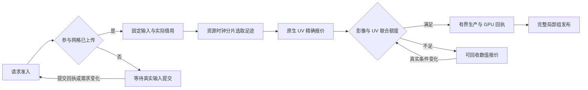

# 后台影像足迹准备与报价持有

后续实现已将显示端接入[后台世界显示切面](SDK_WORLD_DISPLAY_PLAN.md)。下文记录
报价准备检查点及当时的未完成项；当前显示不再运行世界切面生成器或组织UV需求。

影像组发布前必须具备完整的 UV 输出，而不是仅为报价时的可见区域准备输出。
同一不可变地形网格可以跨多次相机更新继续使用；相机露出网格的另一部分时，
先前的投影区域不能证明该部分已准备好。旧实现还会在影像请求准入中同步
组织完整切面，阻塞显示时钟。这是准备与显示之间的边界问题。

## 数据与执行边界

`imagery_candidate.js`使用不可变网格的完整 hull、内部八根纹理树与假定就绪的
下一组影像，计算完整生产范围。生产阶段以 Infinity 保守保留已有精细分支，
不借用相机测量行；这不是显示质量证明。显示仍按当前视点的可见性、region
和原1.25px误差筛选、渲染和统计。外部 TMS/WMTS 适配不变。

`imagery_draws.js`、`imagery_availability.js`及`ImageryPresentation`提供可恢复
迭代器。同步入口只是执行完同一算法，不保留另一套切面逻辑。生产时，未参与
网格仍贡献全局目标，使共享边界一致，但不为它们生成整套输出描述。

`PartitionGroups`管理准入、原生报价及发布；`imagery_footprint_selection.js`
负责输入借用、固定状态、遍历和工作空间；`imagery_footprint_quotes.js`管理
没有载荷持有的完成报价。准备通过独立资源时钟推进，显示回调不执行这个
选择器。Runtime仍使用已有协调器；独立Renderer没有宿主回调时使用合并的一次性
计时器，暂停、上下文丢失或销毁时取消。

每轮最多1024个检查点，沿用约4ms软时间片。检查点间的操作和宿主抢占可能使
实测轮次超出4ms，不承诺硬实时。准入仍有成员签名检查、Map复制及排序等
同步工作；这一增量没有把所有准备工作或所有显示工作搬离主线程。

选择器固定 draw 输入、图像可用状态、世界过渡状态和桥接表；跨暂停不读取
新的相机测量。实际几何/网格及图像先借用再暂停，几何身份、分区表、图源
代次和仍需的目标继续验证。等价描述对象复制或仅相机变化不重做报价；几何
替换、目标撤销、换源及取消仍使任务退出，原生任务收到完成回执后才释放借用。

参与网格尚未上传时直接等待，不启动选择器、不取得准备额度，也不记录容量
拒绝；几何提交沿用现有数据唤醒。准入后、首次借用前输入若消失，任务释放
并重新检查依赖；选择器返回未就绪不能解释成容量不足。额度拒绝仍按原容量
事件等待，不能与这条输入等待混用。

## 容量、拒绝与恢复

选择器的元数据、临时集合和输出描述在分配前向同一资源账本申请额度。偏好
信用最多提前取得现有空闲的64KiB；精确下限仍可独立申请，不为了偏好信用
强制回收其他生产者。结束时按保守数值结构大小收缩，输出与共享工作空间
继续使用既有联合准入，运行总额及分区容量没有提高。

已完成报价若被输出容量拒绝，不能立即删除后重算：重新选取足迹的冷启动
工作空间可能大于这份已知报价所需空间，使“仅差一个字节”的恢复反而卡住。
因此完成报价转成可立即回收的数值备忘，不保留 draw 数组、几何、原生网格、
图像、GPU资源或借用，仅记录单元、字节数及弱身份的数值ID。

`ResourceLedger.memoize/claimMemo`原子交接同一元数据分配，撤销旧句柄，既不
双重记账也不出现无主间隔。重新借用载荷前必须先取得必需工作额度，策略已
收紧为超额时拒绝取得。旧回收回调不能释放新所有者。原样失败的备忘→工作→
备忘探测不制造新的容量事件；真实退款、策略或需求变化才允许后续探测。

该备忘是可选缓存，其他真实生产者能回收它。如果它已被回收，重新计算仍
需要真实的冷启动工作空间；不能承诺低于这个下限的任意容量都能继续。完整
世界范围也可能比当前投影需要更多 UV，是否受限应由真实报价和现有容量决定，
不能借此扩大预算或用旧质量声明达标。

## 验证与剩余工作

确定性合同在实际 ec32582 候选算法上复现完整网格只报价1/4区域；另将实际旧
broker与当前规范选择器组合，隔离验证旧准入仍同步计算完整足迹。后者是边界
负对照，不冒充整个旧分发包。新合同检查等价相机更新、完整范围、固定桥接表、
取消/换源/暂停、配额拒绝、备忘回收、精确差一字节恢复及退出后零占用。

首次完整发布在 GPU 仲裁夹具处失败：夹具冻结时间并手动推进上传，却也交付
了独立Renderer新增的真实资源计时器，导致截止检查前上传队列已被额外推进。
夹具现显式指定资源时钟；16ms仲裁、原渐变像素及最多两个fence的断言均保留。
同一冻结浏览器包的单项实测通过，首次失败DOM、结果及退出证明单独保留。

编码驻留夹具同样需要控制下载观测阶段与生产阶段；生产阶段现在显式交付
`advanceResources()`及`render()`。前置测试还捕获本轮异步改造遗漏的输入等待
边界：参与几何未上传就启动选择器，返回未就绪被记为容量拒绝。真实PNG替换
组在约343KiB占用、34.7MiB共享上限下停滞，证明不是实际容量耗尽。新增合同
在修正前失败，检查等待不分配、借用前输入消失、输入到达后无需改相机或容量
即可恢复。失败DOM、清理前快照及逐次结果保留，不以最终通过覆盖失败记录。

固定CPU组件包含33个不可变网格、128个请求叶节点及一个四影像候选组。五轮
交替运行，旧全投影与新完整范围的242行输出哈希一致。中位数1.80ms与2.33ms，
该诊断每轮256个检查点，新路径分为23轮，最长0.484ms；手动连续执行、没有宿主等待，不能作为完整SDK
速度或输入响应验收。该诊断累计计入301530字节工作元数据，不是实际常驻或
浏览器峰值。证据在`viewer_verify_output/prepared_display_20261020/`。

桌面 `terrain_model_renderer`直接绘制已发布cut，是完整P2的参考。本增量只完成
后台影像足迹报价准备，**没有完成持久的已提交显示计划及后台显示后继**。
当前显示仍组织目标、投影过滤、覆盖和分区需求，原生准备、GPU工作、宿主等待、
联合预算及P0/P1/P3/P4继续独立验收。冻结地形/合成影像和程序化相机测试也
不能代替真实天地图、DOM输入到呈现或移动设备长测。

最终冻结代码通过19项完整baseline，编译警告0；Intel Vulkan浏览器351项/
12条轨迹通过，采样空白/缺图0，三组网络轨迹全程引擎错误0，退出后的资源/
请求/计时器归零。1.25px与176160768字节总额保持。C ABI46/Worker45保持，
Wasm471448字节且哈希不变，核心包1073295字节，独立Worker247915字节。
源码、实际压缩图、Native归档和产品资产分别核对。

最终发布driver在Web夹具的短暂上传状态观测处退出1；该夹具显式时钟修正后，
从Web阶段续作，完整Web、SDK归档及站点阶段均通过。原生/Wasm/压缩SDK阶段的
生产代码与字节未变，不重复构建；`release-result.json`逐阶段记录回执，不将
续作表述为同一次driver从头退出0。三个Web失败、诊断及修正前回归均保留。

本轮大倾角停稳8.4–15.3秒，Direct正常网络相机到提交p95为138.4ms，连续提交
间隔p95为187.4ms，工业级目标未通过。工作量依赖显示时钟，不能将单轮整场
变化归因于本增量。只更新本机18766，不部署49；完整后台显示计划及其余
P0/P1/P3/P4继续保留。
