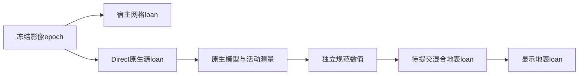

# 测量生产、混合发布与源数据的持有关系

CBDAM和八根影像金字塔没有改变。本次问题发生在合作调度的等待、缓存回收和
局部发布之间：逻辑上仍需要的数据，未必仍有物理所有者。相机快速变化和压力
回收使这些缺口更容易出现；最终能重试收敛不代表中途的引擎错误可以接受。

## 已确定的持有缺口

| 边界 | 旧行为及后果 | 修复后的约束 |
| --- | --- | --- |
| 准备中的混合地表 | 复制了`workerMeasurements`，但仅当前/已显示地表取得数值loan。新影像计划释放旧表后，再提交混合地表会读到退休数据 | `replacement.mixed`也是数值所有者；构造时同步loan，更新当前计划不撤销它。提交后由显示所有者接续，丢弃则释放 |
| 可选原生UV布局 | 元数据等待授权前保存复用模型ID，等待期间闲置模型可能被压力回收，恢复后status2 | 仅保留句柄，在真正打开模型时读取ID。已关闭就按原始CBDAM源重新生产，活着才复用，不为可选缓存阻塞回收 |
| Direct冻结模型 | 宿主XYZ副本的loan不能固定C++源。地形发布推进并回收原生缓存后，旧影像任务仍可能需要读取原生模型 | 影像epoch另外取得原生mesh loan，和宿主loan一起覆盖冻结任务寿命；接纳后继先借新源，再释放旧源 |
| 候选源寻址 | 模型任务在等待额度前把plan ID复制成标量，候选发布/退休后还使用旧ID | bounds和精测传递epoch的当前源寻址，直到打开模型时读取；资源ID保持不变，已打开的C++模型继续持有自己的冻结源 |
| Direct请求首次等待 | 请求选定地形后，先等待宿主任务，再进入准备器借用输入。等待期间地形发布可先释放所选宿主和原生源 | Direct的首次协作检查点移到epoch取得输入之后，取消后不继续访问旧源；Worker继续其RPC调度，不推迟依赖额度的quote |

`NativeMeasurementProduction`的闲置模型仍可回收。数值结果、历史、传输和显示
只借用封存的测量行，不因保留数值而固定地形。Direct的epoch源loan只为尚在
执行的模型/测量工作存在，完成、取消或销毁后退出。Worker已有的原生网格loan
通过同一个`holdSurface`边界继续使用；不添加第二套地形或纹理调度。

原生源loan固定已有分配，不创建XYZ/UV副本，也不另加一份载荷收费；
`NativeMeshBudget`继续观察真实物理占用。它会让仍有读者的数据变得不可回收，
这正是应该呈现的工作集成本。不能提前退款或扩大总额掩盖不足。1.25px目标、
176160768字节共享总额、原上传窗口及每批GPU校验保持。

## 证据与验收边界

前四项回归均先在相应旧实现中失败，再在新实现中通过：

- 真实Renderer准备一个未提交混合组，替换测量计划并关闭调用方loan，然后提交。
  同时验证未提交时的后继、暂停、重建、丢失、销毁，以及最终零占用。
- 真实CBDAM中不同mesh共享UV布局。第二个模型等待元数据授权时回收第一个，
  恢复后仍产生与冷生产逐字节相同的规范测量；活布局仍复用，统计与实际一致。
- Direct暂停在真正的epoch边界，发布另一组地形，退出旧宿主帧并清空原生缓存。
  恢复原读者必须完成原模型版本的测量，完成后的数值不能继续固定旧mesh。
- 真实原生模型等待授权时退休其计划描述，保持同一mesh的驻留所有权；恢复后
  通过当前寻址完成，不能靠捕获错误后重新启动来通过。

改前浏览器调用栈确认退休行是在`rebuildImageryDraws`中释放，随后混合提交在
`syncMeasurementLoans`中再次引用。只修前两个缺口后的中间诊断明确记录了
`surface model source is unavailable`，因此没有把所有status2归为UV复用问题。
失败现场和最终门控均保存在
`viewer_verify_output/measurement_lifetime_20261020/`。

浏览器网络轨迹现在通过`onDiagnostic`记录全程的引擎错误计数和最多8个首例，
防止最终状态的有界诊断环遗漏早期错误。帧回调、影像/运行时更新和GPU准备/
恢复失败即使随后恢复也不能通过；预设的网络503重试仍按原规则验收。

fd949f1冻结代码通过19项完整baseline、完整SDK发布及Intel Vulkan浏览器351项/
12条轨迹。三组网络轨迹的全程引擎错误计数均为0；采样白屏/缺图为0，
销毁后的资源/请求/计时器为0。原1.25px目标、176160768字节总额保持。
源码依赖图、实际压缩Worker、Native安装包和产品资产分别核对。

本轮斜视停稳8.1–13.9秒，Direct正常网络相机到提交p95为86.7ms，连续帧间隔
p95为150.2ms，工业级目标仍未通过；单次依赖显示时钟的轨迹不能证明因果提速。
C++、C ABI46和Worker协议45保持；Wasm471448字节且哈希不变，核心包1059422
字节、Worker246910字节。只更新本机18766，49仍只作数据上游。

宿主帧回调因果定位、真实图源/设备长测、受限容量联合发布和其余P0–P4仍须
独立验收；本修复不构成它们全部通过的证明。部署与测试清理以同目录回执为准。

## 首次宿主等待的补充回归

后续显示查询优化的发布门控记录了一次Direct弱网`imagery_refresh_failed`，
消息为`Mesh payload has been released`。三个轨迹最终仍达到精度，但全程错误
门控按约定拒绝发布。该失败报告没有栈，单独的三轨迹浏览器诊断没有重现；
不能把那次未重现当作问题不存在的证据。

`native_request_lifetime_contract.js`用真实Wasm在首次宿主等待处暂停，发布另一组
地形、退休旧宿主所有者并清空闲置原生缓存，然后恢复请求。旧源码及实际旧
压缩分发包都稳定抛出相同消息，栈为`ownership.hold -> holdNativeSurface ->
ImageryPreparation.prepareImagery -> LocalTerrainExecution.planImagery`，确认这条
所有权空窗确实存在，而不依赖弱网或CPU速度。

Direct适配器在共享准备器中安装一个持有后检查点，不给每轮请求增加逐mesh的Native借用。
epoch沿用原有源loan；其生命周期覆盖该检查点及后续原生工作。它仍使用原
4ms协作窗口，廉价额度/quote调用之间也必须检查同一时钟。等待后会检查实际
epoch身份，不能使用已经撤销的局部变量继续。Worker已有RPC外层调度，依赖
额度的quote必须立即返回；本回调只由Direct安装，既有Worker信用轮合同保持。

新回归同时覆盖完成、取消、注入异常和等待期间销毁；借用不重复计Native载荷，
旧源完成后不可再次获取，退出后账本为0。最终完整门控与部署回执位于
`viewer_verify_output/imagery_lookup_20261020/`。这是第五条边界的工程修复，
不能据此推断所有并发路径或工业级时延都已验收。
